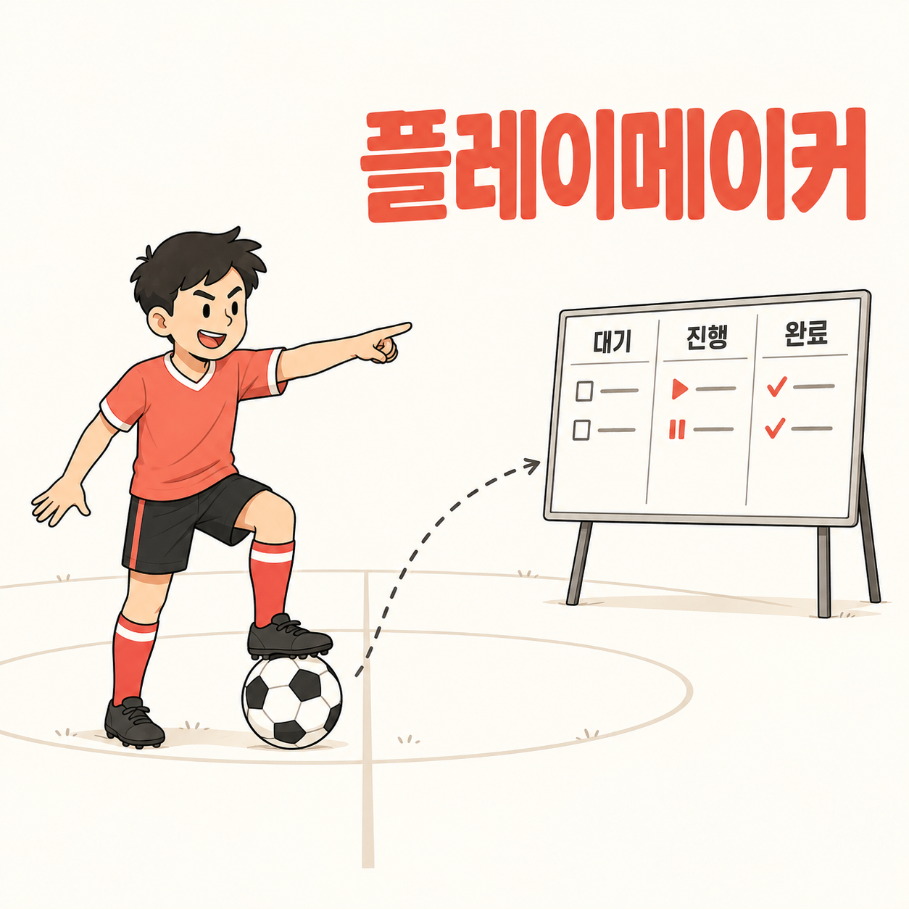

[English](README.md) | 한국어 | [中文](README.zh.md) | [日本語](README.ja.md) | [Español](README.es.md)

# playmaker (플레이메이커)

<p align="center">
  
</p>

> **Claude Code 안에서 보는 골 진행 보드 — 지금 어디까지 왔고, 무엇을 하고 있고, 무엇이 나를 기다리는지 한눈에.**

골잡이(goaljaby)가 골을 넣는다면, 플레이메이커는 경기 전체를 읽습니다. playmaker는 goaljaby 골 폴더의 `PLAN.md`와 `PROGRESS.md`를 읽어 옆 패널에 **대기 · 진행 · 완료** 보드를 그리는 Claude Code mod입니다. 카드 하나가 작업 하나이고 마일스톤 태그가 붙으며, 사람이 필요한 작업은 ⏸로 표시되고, 입력창 위에는 한 줄 요약이 뜹니다.

[빠른 시작](#빠른-시작) • [보이는 화면](#보이는-화면) • [읽는 형식](#읽는-형식) • [명령](#명령) • [요구 사항](#요구-사항)

---

## 빠른 시작

### 1. 마켓플레이스 추가

```
/plugin marketplace add https://github.com/fivetaku/gptaku_plugins.git
```

### 2. 설치

```
/plugin install playmaker
```

### 3. Claude Code 재시작

### 4. 보드 열기

```
/playmaker
```

현재 폴더에서 하위 2단계까지 찾아 가장 최근에 바뀐 골 폴더를 엽니다. 진행 중이고 최근 7일 안에 바뀐 골이 있으면 세션을 시작할 때 보드가 저절로 열립니다.

---

## 보이는 화면

```
인증까지 붙인 MVP를 배포한다.
골 1/3 · 진행 M2 · 작업 2/6 · ⏸ 사람 대기 1
[마일스톤별 보기] [완료 펼치기]

대기 (2)                 진행 (2)                      완료 (2)
· [M2] 마일스톤 검증 실행  ▶ [M2] OAuth 콜백을 연결한다   ✓ M1 2건
· [M3] 배포 설정을 만든다  ⏸ [M2] 운영자 승인 계정 대기
```

- **상태 3열.** 카드 하나가 작업 하나이고 `[M2]`처럼 마일스톤이 붙습니다. 여러 마일스톤이 동시에 진행 중이면 모두 보입니다.
- **사람 대기는 따로.** `[!]` 표시가 된 작업이나, 기존 형식에서 진행 기록에 사람을 기다린다고 적힌 마일스톤은 ⏸로 보입니다.
- **좁으면 세로로.** 72열 미만이면 진행, 대기, 완료 순서로 쌓고, 완료는 마일스톤별 개수로 접습니다.
- **마일스톤별 보기.** 버튼 하나로 마일스톤마다 체크리스트(`[ ] [>] [x] [!]`)를 보는 화면으로 바뀝니다.
- **실시간.** PLAN.md나 PROGRESS.md가 바뀌면 3초 안에 반영됩니다.
- **카드에서 바로 지시.** 카드를 누르면 그 아래에 작업 상태별 행동 버튼이 펼쳐집니다. 사람 대기 작업은 승인하고 진행 / 무엇을 확인해야 하나? / 보류, 진행 중 작업은 진행 상황 알려줘 / 막힌 게 있나? 같은 식이고, **직접 쓰기…**로 원하는 말을 보낼 수도 있습니다. 지시는 작업 ID가 붙어 지금 세션에 바로 들어갑니다. 세션이 답을 마칠 때까지 다른 카드는 잠가서 반대 지시가 연달아 들어가지 않습니다. playmaker는 여전히 PLAN.md를 고치지 않고, 마커는 에이전트가 바꿉니다.
- **브라우저로 열기 · 닫기.** 패널의 **브라우저로 열기** 버튼은 웹 보드를 켜서 기본 브라우저로 열고, 패널에 누를 수 있는 링크를 남깁니다. **✕ 닫기**는 패널과 입력창 위 요약 줄을 함께 내리며, `/playmaker`로 다시 엽니다.
- **불일치 경고.** PLAN 체크리스트와 PROGRESS가 서로 다르게 말하면 추측하지 않고 ⚠로 알려 줍니다.

---

## 읽는 형식

| 골 폴더 | 작업 상태 출처 |
|---|---|
| goaljaby 0.7 이상 | PLAN.md 마일스톤별 체크리스트 `- [>] M2-T1: 작업` (`[ ]` 대기 · `[>]` 진행 · `[x]` 완료 · `[!]` 사람 대기) |
| goaljaby 0.6 이하, 사람이 쓴 PLAN | PROGRESS.md의 마일스톤 상태와 범위(Scope) 한 줄에서 추정. 추정한 카드는 흐리게 보입니다 |

표 형식 PLAN(`| M1a 이름 | 범위 |`)과 `### M2 이름` 헤딩도 읽습니다. playmaker는 읽기만 하고 골 폴더에 아무것도 쓰지 않습니다.

---

## 명령

| 명령 | 하는 일 |
|---|---|
| `/playmaker` | 현재 폴더 아래에서 가장 최근 골 폴더를 찾아 보드를 엽니다 |
| `/playmaker <폴더>` | 특정 골 폴더의 보드를 엽니다 |
| `/playmaker web [폴더]` | 브라우저 보드(아래)를 켜고 주소를 알려 줍니다 |

명령은 텍스트 요약도 함께 돌려주므로, 패널을 그릴 수 없는 곳에서도 쓸모가 있습니다.

---

## 요구 사항

- [Claude Code](https://code.claude.com/docs/en/plugins/mods/overview) **v2.1.287 이상**(mods), 터미널 또는 데스크톱 앱 Code 탭
- 터미널에서 패널을 옆에 붙이려면 `/tui fullscreen`과 110열 이상이 필요합니다. 그보다 좁으면 입력창 위에 뜹니다
- 패널을 그리지 못하는 호스트(Paseo, `claude -p`, VS Code 채팅, 클라우드 세션)에서는 `/playmaker`가 텍스트 요약으로 답하고, `/playmaker web`으로 같은 보드를 로컬 웹 페이지로 볼 수 있습니다(127.0.0.1 전용, 2초마다 갱신, Node 22.18 이상)
- **Paseo:** Paseo에서 돌고 있으면 스스로 알아채고, 진행 중인 골이 있으면 웹 보드를 켜서 Paseo 브라우저 탭으로 엽니다. 다음부터는 그 탭을 다시 쓰니, 오른쪽 분할 칸으로 한 번만 옮겨 두면 됩니다. 웹 보드 위쪽에서 골을 작업 중인 Paseo 세션을 고르면 카드에서 같은 행동을 그 세션에 보낼 수 있습니다
- 터미널에서 마우스 클릭은 `/tui fullscreen`에서 됩니다. 아니면 Ctrl+X 다음 Tab으로 패널에 들어가 화살표와 Enter로 고릅니다

### 함께 쓰면 좋은 플러그인

| 플러그인 | 더해지는 것 |
|--------|--------------|
| `goaljaby` 0.7 이상 | playmaker가 읽는 작업별 체크리스트를 기록합니다 |

---

## 라이선스

MIT · [면책 조항](DISCLAIMER.md)

---

<div align="center">

**골잡이로 골을 넣고, 플레이메이커로 경기를 읽는다.**

</div>
